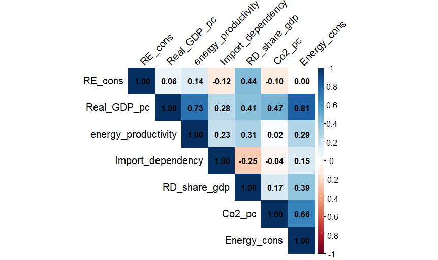
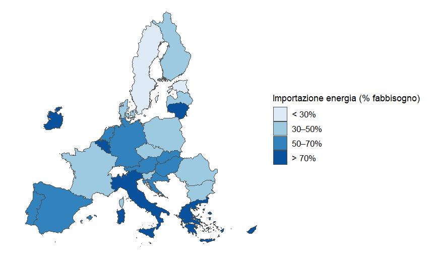
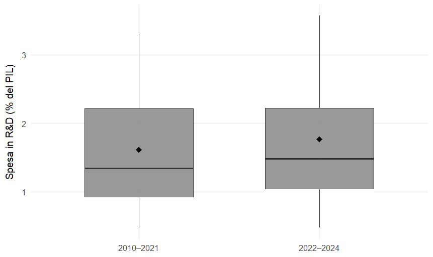
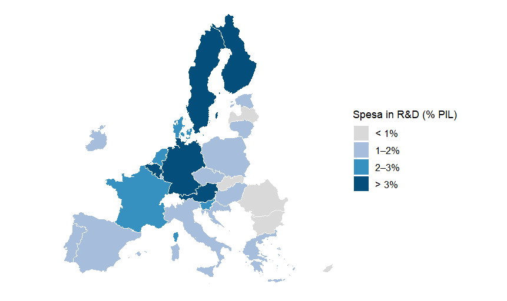
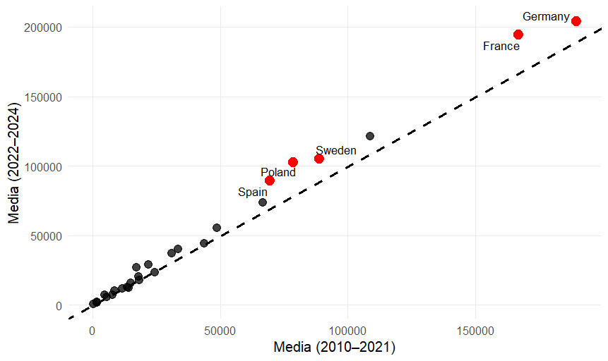

# Determinanti del consumo di energia rinnovabile nell'Unione Europea
### Determinants of Renewable Energy Consumption in the European Union

**Tesi magistrale in Economia, Finanza e Politiche Pubbliche**  
Università degli Studi di Cagliari | 2026

**Tecnologie:** `R` · `Panel Data` · `Econometria` · `Data Visualization` · `Statistical Analysis`

---

## Panoramica del progetto

Questo progetto analizza le determinanti economiche, energetiche, tecnologiche e climatiche del consumo di energia rinnovabile nei 27 paesi dell'Unione Europea, utilizzando un dataset panel relativo al periodo **2010–2024**.

L'obiettivo è identificare i fattori associati al consumo di energia da fonti rinnovabili e verificare se la crisi energetica europea del 2021–2022 abbia modificato tali relazioni.

L'analisi combina tecniche di elaborazione dei dati, statistica descrittiva, visualizzazione e modelli econometrici panel a effetti fissi.

Il progetto è stato sviluppato nell'ambito della mia tesi magistrale in Economia, Finanza e Politiche Pubbliche presso l'Università degli Studi di Cagliari.

## Domande di ricerca

L'analisi si concentra su due domande principali:

1. Quali fattori economici, energetici, tecnologici e climatici sono associati al consumo di energia rinnovabile nei paesi dell'Unione Europea?
2. La crisi energetica del 2021–2022 ha modificato la rilevanza di questi fattori?

## Dataset e fonti

Il dataset comprende **27 paesi dell'Unione Europea osservati annualmente dal 2010 al 2024**.

| Caratteristica | Descrizione |
|---|---|
| Unità di osservazione | Paese × anno |
| Copertura geografica | 27 paesi UE |
| Periodo | 2010–2024 |
| Osservazioni complessive | 405 |
| Osservazioni nelle regressioni | 378 |
| Valori mancanti nel dataset finale | 0 |
| Formato | Excel (.xlsx) |

La riduzione delle osservazioni nelle regressioni è dovuta all'inclusione della variabile relativa alle emissioni di CO₂ ritardata di un anno.

### Variabili utilizzate

| Variabile | Unità di misura | Fonte |
|---|---|---|
| Consumo di energia rinnovabile | GWh | Eurostat |
| PIL pro capite | Euro | World Bank |
| Consumo energetico pro capite | Toe/abitante | Eurostat |
| Produttività energetica | Euro/kgoe | Eurostat |
| Spesa in ricerca e sviluppo | % del PIL | Eurostat |
| Dipendenza energetica | % | Eurostat |
| Emissioni di CO₂ pro capite | Tonnellate/abitante | World Bank |
| Radiazione solare | kWh/m² | ERA5 – Copernicus |
| Velocità del vento | m/s | ERA5 – Copernicus |
| Temperatura media | °C | ERA5 – Copernicus |

**Variabile dipendente:** consumo di energia rinnovabile, espresso in GWh e trasformato in logaritmi nelle specificazioni principali.

Il dataset finale è disponibile nel file [`dataset.xlsx`](dataset.xlsx), una volta caricato nel repository.

---

## Metodologia

### Analisi esplorativa dei dati

La prima fase del lavoro comprende:

- Costruzione e organizzazione del dataset panel.
- Analisi delle distribuzioni delle variabili.
- Confronti tra paesi e periodi temporali.
- Analisi delle correlazioni tra regressori.
- Individuazione di potenziali problemi di multicollinearità.
- Produzione di grafici statistici e mappe tematiche.

### Modelli econometrici panel

L'analisi utilizza modelli panel con **effetti fissi per paese e per anno (Two-Way Fixed Effects)**.

Questa impostazione consente di controllare le caratteristiche strutturali dei paesi che rimangono costanti nel tempo e gli shock comuni ai paesi europei in ciascun anno.

La variabile dipendente viene trasformata in logaritmi per gestire l'asimmetria della distribuzione del consumo energetico.

Le emissioni di CO₂ pro capite sono incluse con un ritardo temporale di un anno, per attenuare alcuni potenziali problemi di simultaneità.

Le stime utilizzano **errori standard robusti clusterizzati a livello nazionale (HC1)**.

### Analisi dello shock energetico

Per studiare eventuali cambiamenti nelle relazioni tra le variabili viene introdotta una dummy temporale:

- **Pre-shock:** 2010–2021
- **Post-shock:** 2022–2024

La dummy Post viene interagita con i regressori di interesse per verificare se le associazioni cambino dopo lo shock energetico.

Per le variabili climatiche vengono utilizzate le medie del periodo precedente allo shock, standardizzate mediante z-score e interagite con la dummy Post.

### Multicollinearità

La multicollinearità viene valutata attraverso una matrice di correlazione e il Variance Inflation Factor (VIF).

Il PIL pro capite presenta un VIF pari a **14,25**, superiore alla soglia convenzionale di 10.

Per limitare questo problema, vengono stimate tre specificazioni alternative, contenenti rispettivamente:

1. PIL pro capite.
2. Produttività energetica.
3. Consumo energetico pro capite.

### Analisi di robustezza

La stabilità dei risultati viene verificata attraverso:

- Anticipazione dell'inizio del periodo post-shock al 2021.
- Utilizzo del consumo di energia rinnovabile in GWh per milione di abitanti come variabile dipendente alternativa.

---

## Risultati principali

### Potenziale eolico

Il risultato più stabile riguarda il potenziale eolico.

Nel periodo successivo allo shock energetico, un incremento di una deviazione standard del potenziale eolico è associato a un consumo di energia rinnovabile superiore di circa **14%**, sulla base di coefficienti compresi tra 0,131 e 0,134 nella specificazione log-lineare.

L'associazione risulta statisticamente significativa (**p < 0,01**) e si mantiene nelle analisi di robustezza.

### Radiazione solare e temperatura

Non emergono associazioni differenziali statisticamente significative tra queste variabili climatiche e il consumo di energia rinnovabile nel periodo successivo allo shock.

### Emissioni di CO₂

Le emissioni di CO₂ pro capite ritardate di un anno mostrano un'associazione negativa, con significatività statistica moderata (**p < 0,10**).

Un incremento di una tonnellata di CO₂ pro capite è associato a un consumo di energia rinnovabile inferiore di circa il **5–6%**.

Il risultato deve essere interpretato come associazione statistica, non come relazione causale.

### Dipendenza energetica

Nel periodo precedente allo shock non emerge un'associazione statisticamente significativa.

Nel periodo successivo, l'interazione tra dipendenza energetica e dummy Post presenta un coefficiente positivo, corrispondente a circa **+0,4%** di consumo di energia rinnovabile per un punto percentuale aggiuntivo di dipendenza.

La significatività è tuttavia limitata ad alcune specificazioni: il risultato non può quindi essere considerato robusto.

### Altre variabili economiche e tecnologiche

PIL pro capite, spesa in ricerca e sviluppo, produttività energetica e consumo energetico pro capite non mostrano coefficienti statisticamente significativi nelle specificazioni considerate.

### Sintesi dei risultati

| Variabile | Risultato | Robustezza |
|---|---|---|
| Potenziale eolico × Post | Associazione positiva | Elevata |
| Radiazione solare × Post | Non significativa | — |
| Temperatura × Post | Non significativa | — |
| CO₂ pro capite ritardata | Associazione negativa | Significatività moderata |
| Dipendenza energetica × Post | Associazione positiva | Limitata |
| PIL pro capite | Non significativo | — |
| Spesa in R&S | Non significativa | — |
| Produttività energetica | Non significativa | — |
| Consumo energetico pro capite | Non significativo | — |

---

## Visualizzazioni

Il progetto comprende visualizzazioni statistiche e cartografiche per descrivere le differenze tra i paesi europei e l'evoluzione delle variabili nel tempo.

### Correlazioni tra le variabili

La matrice permette di individuare le principali relazioni tra i regressori e di valutare preliminarmente eventuali problemi di multicollinearità.

### Dipendenza energetica nell'Unione Europea

Distribuzione geografica della dipendenza energetica, misurata come percentuale del fabbisogno energetico coperto dalle importazioni nette.

### Spesa in ricerca e sviluppo: confronto pre e post-shock

Distribuzione della spesa in R&S in percentuale del PIL nei periodi 2010–2021 e 2022–2024.

### Distribuzione geografica della spesa in R&S

Confronto tra i paesi europei nella spesa destinata alla ricerca e sviluppo.

### Consumo di energia rinnovabile prima e dopo lo shock

Confronto tra il consumo medio di energia rinnovabile nel periodo 2010–2021 e nel periodo 2022–2024, distinto per paese.

---

## Competenze applicate

Il progetto ha richiesto l'applicazione di competenze in diverse aree della Data Analysis.

**Data Management**
- Raccolta e integrazione di dati da fonti differenti.
- Costruzione di un dataset panel.
- Pulizia, trasformazione e validazione dei dati.
- Gestione di variabili temporali e ritardi.

**Statistical Analysis**
- Statistica descrittiva.
- Analisi delle correlazioni.
- Diagnostica della multicollinearità.
- Interpretazione dei coefficienti e della significatività statistica.

**Econometric Modeling**
- Regressioni panel a effetti fissi.
- Controllo dell'eterogeneità non osservata.
- Modelli con interazioni.
- Errori standard robusti clusterizzati.
- Analisi di robustezza.

**Data Visualization**
- Produzione di grafici statistici.
- Confronti temporali e territoriali.
- Visualizzazione di correlazioni.
- Creazione di mappe tematiche.
- Comunicazione dei risultati quantitativi.

**Software principale:** R.

---

## Limiti dell'analisi

I risultati devono essere interpretati considerando alcune limitazioni metodologiche:

- **Aggregazione geografica:** l'analisi nazionale non permette di osservare differenze regionali o locali.
- **Variabili omesse:** il modello non include direttamente indicatori di qualità istituzionale e politiche energetiche nazionali.
- **Definizione dello shock:** l'utilizzo di una discontinuità temporale rappresenta una semplificazione di un fenomeno economico complesso.
- **Capacità esplicativa:** le specificazioni presentano valori di R² compresi tra 0,05 e 0,16.
- **Interpretazione:** i coefficienti descrivono associazioni statistiche e non identificano necessariamente effetti causali.

---

## Fonti

I dati utilizzati provengono da:

- **Eurostat:** indicatori energetici, economici e di ricerca e sviluppo.
- **World Bank:** indicatori macroeconomici ed emissioni di CO₂.
- **Copernicus Climate Change Service (ECMWF):** dati climatici ERA5.

Il dataset finale è il risultato dell'integrazione e della rielaborazione delle fonti originali.

## Autore

**Alberto Marchi**

Laurea magistrale in Economia, Finanza e Politiche Pubbliche  
Università degli Studi di Cagliari

**Email:** albion0029@gmail.com
